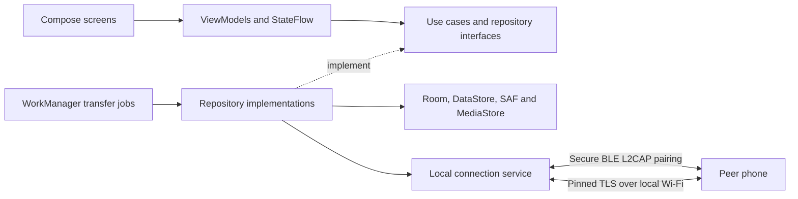

# LanChatShare architecture

## Device boundaries

## Gradle modules

| Module | Responsibility |
|---|---|
| :app | Hilt composition root, splash gate, navigation, notifications and incoming Android share intents |
| :core:design | Compose tokens, adaptive layouts, accessible controls and brand assets |
| :core:domain | Kotlin models, repository contracts and use cases |
| :core:data | Room migrations and FTS, peer trust, outbox, transfer journal, DataStore and storage adapters |
| :core:protocol | Versioned serializable envelopes, validation, transfer manifests and pairing state machine |
| :core:connectivity | BLE, network selection, local discovery, TLS, WebSockets and foreground service |
| :core:transfers | Streaming I/O, verification, resumable jobs and WorkManager integration |
| :feature:profile, :feature:chats, :feature:nearby, :feature:share, :feature:library, :feature:settings | Screen state, user actions and Compose UI |
| :benchmark | Startup and scrolling baseline profiles |

Feature modules depend on domain and design. Android adapters implement domain contracts. Persist the trimmed display name, random UUID and avatar colour in one DataStore transaction before navigation. Count user-perceived characters. Hold the splash until the first read resolves. A read error shows retry and preserves the existing profile. Exclude identity and chat data from Android cloud backup. Explicit encrypted archive restores omit keys and trust records.

## Pairing and sessions

1. Advertise the service UUID, with version, dynamic PSM, ID suffix and UTF-8 name prefix in the scan response. Android authenticates and encrypts a Bluetooth LE L2CAP stream. The system controls any bonding prompt.
2. Commit to role-bound serialized hellos before revealing UUID, full name, colour, identity public key and fresh 256-bit nonce. Sign the ordered transcript with the Android Keystore identity. Compare six digits on both devices unless both already recognize the SHA-256 SPKI pins. Exchange signed confirmations, then a random one-use token. Persist verified peers in Room. Tokens expire from process memory after two minutes. The signed hello also includes the DER certificate, its SHA-256 digest and up to eight Wi-Fi address/port hints. Verify the certificate digest and match its public key to the transcript signing key. Persist the certificate digest alongside the SPKI pin. Older v1 installations can still pair using their SPKI pin. A Wi-Fi-connected phone offers its non-VPN Wi-Fi interface addresses and planned TLS port 47831. With no eligible network it offers an empty list. Milestone C supplies the listener, downstream hotspot interface selection and reachability checks.
3. Register a local DNS-SD service with display metadata. Merge records by ID. Treat advertisements, UDP replies and Bluetooth endpoint hints as candidates. Validate interface scope including IPv6 zone, bind traffic to the LAN and reject redirects or cellular routes. Bind the listener to the selected interface address. For a hotspot host enumerate candidate downstream addresses and validate reachability from the clients, without assuming a gateway address. Rebind after network changes. Authenticate both peer keys before serving any application route. Consume the first-session token once inside TLS. Reconnect using stored pins and fresh proof of possession.
4. Netty accepts mutually authenticated TLS connections and CIO dials them. The existing Bluetooth identity signs a weekly RSA issuer for the device UUID, which signs the separate RSA transport key. Both delegated certificates carry the UUID-based DNS name and an expiry. Each endpoint verifies both signatures, validity and the stored Bluetooth SPKI pin. The client uses the peer's certified DNS name for TLS while connecting to the discovered address. Key rotation and changes to the trust table restart the listener and sessions. Forgetting a peer cancels its queued messages.

## Application protocol v1

Negotiate a common major version, reject unsupported majors with an upgrade message and ignore unknown optional fields. A WebSocket envelope carries version, event UUID, sender ID, conversation UUID, sender sequence, type and payload. Authenticate the sender against the session. Events include profile changes, messages, replies, edits, reactions, typing, read receipts, transfer offers, decisions and acknowledgements. Limit control-frame sizes and expire transient typing state.

Persist messages and per-recipient outbox entries in one transaction. Acknowledge after durable receipt. Unique sender/event keys make redelivery idempotent. Apply edits only from the original author, in revision order. Group creation distributes an owner-managed membership revision to mutually verified members. Fan each message out to authorized members of its revision. Keep offline deliveries on the sender. Local deletion hides the message on that installation.

Each transfer offer identifies the intended recipient, transfer UUID, immutable file IDs, sanitized relative paths, lengths and SHA-256 digests. Accept per recipient before enabling authenticated HTTPS range reads. Reject path traversal, name collisions that would overwrite existing files, invalid ranges and changed manifests. Stream into private partial storage, record durable verified chunk boundaries, and resume only against the same content identity. Require 206 and a matching Content-Range for resumed reads. Verify the full digest before publishing and record completion by transfer and file ID. Recover interrupted publication by reconciling the journal with the pending destination. Report low space, lost URI permission and missing source as actionable job states.

## Physical acceptance checks

- A: Fresh install offline, submit a trimmed emoji name, kill and restart, edit name and restart again. Check invalid input, TalkBack, 200% text, dark mode and tablet rotation.
- B: Pair two phones. Compare both codes, cancel, retry, verify changed keys require confirmation and denied Bluetooth permission can recover.
- C: Turn mobile data off. Use a router, then host phone plus two clients. Send in both directions including to the host. Disable multicast, leave/rejoin, switch the host, and exercise an isolated guest network. Distinguish a verified connection from discovery.
- D: Send group messages with one member offline. Rejoin, check deduplication and delivery states, edit a name during chat and confirm live updates.
- E: Interrupt a multi-chunk transfer, kill the process, resume and compare hashes at both ends. Test low space, revoked source access, APK consent, duplicate requests and a file larger than 4 GiB.
- F: Reconcile Library categories, search and totals against completed transfers. Check incoming and outgoing records after an external file deletion.
- G: Check foreground/background transitions, notification actions, biometric lock, encrypted restore, battery use and simultaneous transfers on multiple manufacturers.

## Debug throughput measurement

A user starts both ends of a test on the active paired route. The sender binds port 47839 to the selected local address for a single TLS control connection. The receiver binds the outbound socket to the same network used by that peer. Each side verifies the existing identity binding and the client checks the device hostname. After size agreement, TLS carries a random 32-byte proof and an ephemeral TCP port. Only the expected peer address presenting that proof receives the synthetic buffer. The receiver counts the agreed bytes and acknowledges each test on TLS. The second test streams the same number of bytes through the TLS socket. Cancellation, route loss and timeout close all probe sockets. Only debug source sets contain this protocol. File grants, file bytes and chat messages stay on their existing authenticated paths.
