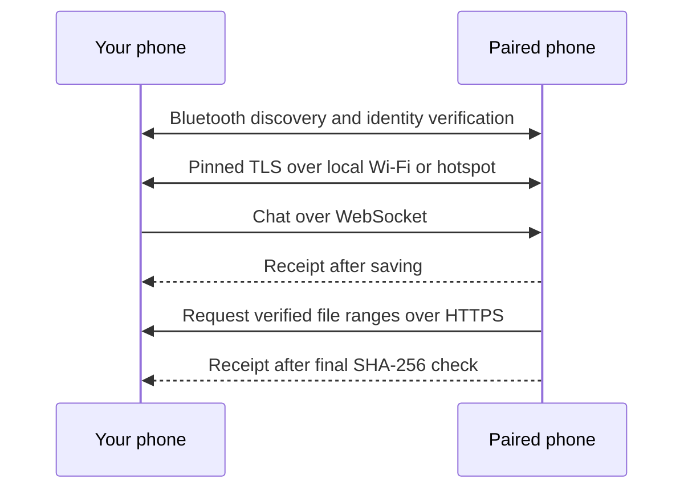
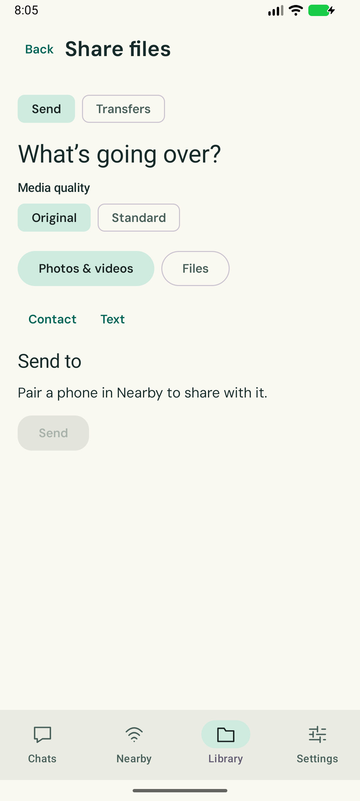
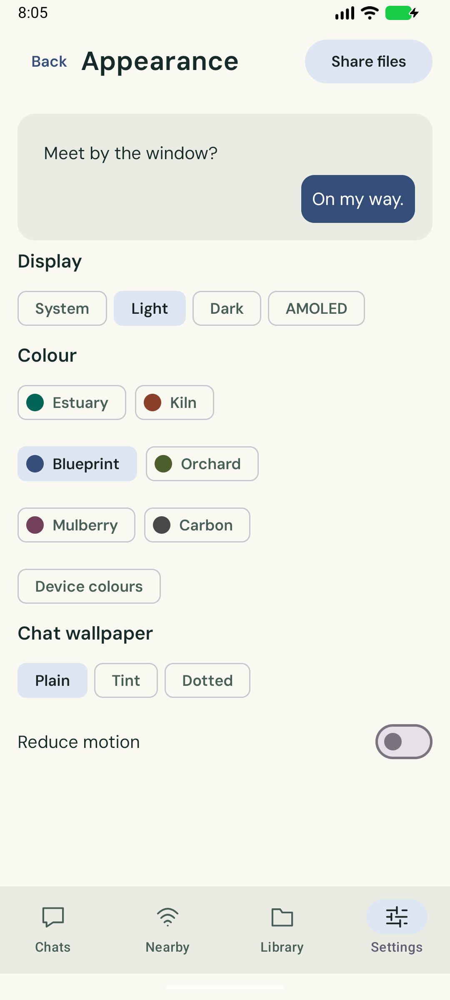

# LanChatShare

[](https://github.com/rudraprajapati0210/LanChatShare/actions/workflows/android.yml)
[](LICENSE)


LanChatShare brings WhatsApp-style chat and Quick Share-style file transfers to the same local network. Choose a name, verify the phone beside you, and send a message or a file over Wi-Fi. It works with mobile data off, including when one phone hosts the hotspot. There are no accounts or cloud services.

[Download the debug prerelease](https://github.com/rudraprajapati0210/LanChatShare/releases) · [Two-phone checklist](docs/TWO_PHONE_CHECKLIST.md) · [Security](SECURITY.md)

## What you can do

- Set a display name once. DataStore remembers it, and Settings lets you change it.
- Find a phone over Bluetooth, compare the pairing code, then open a one-to-one conversation. Messages queue locally until the other phone saves them.
- Send an image in chat or open **Share files**. Transfers resume at verified offsets and check the final file hash. The Library indexes sent and received items by category, contact and date.
- Reply or mark messages read from notifications. Enable **Stay reachable** to receive messages while the app is in the background.
- Choose a palette, dark or AMOLED mode, a conversation wallpaper and reduced motion. Chat uses grouped bubbles and the Share hub uses Material 3 Expressive motion.

## How it works



TLS terminates on the paired phones. Chat and file bytes travel over Wi-Fi. Pairing identity keys authorize separate TLS keys so a certificate can rotate while the peer remains trusted. [Protocol](docs/PROTOCOL.md) · [Architecture](docs/ARCHITECTURE.md)

## Screenshots

| Share hub | Appearance |
|---|---|
|  |  |

| Planned screenshot | Capture |
|---|---|
| Conversation | A verified peer, an image and its delivery receipt |
| Transfers | A large file resuming after reconnect |

[How to contribute screenshots](docs/screenshots/README.md) · [Design system](DESIGN.md)

## Build and run

Install Git, JDK 25 (the build verification environment), Android SDK Platform 37.1 and Build Tools 36.0.0. Set `JAVA_HOME` and `ANDROID_HOME`, or select the SDK in Android Studio. Gradle downloads dependencies on the first build.

```sh
git clone https://github.com/rudraprajapati0210/LanChatShare.git
cd LanChatShare
./gradlew :app:assembleDebug testDebugUnitTest lintDebug
```

In Windows PowerShell use `.\gradlew.bat :app:assembleDebug testDebugUnitTest lintDebug`. Install `app/build/outputs/apk/debug/app-debug.apk` on both phones. Use the same signing key for updates. A local or CI debug APK signed with another key cannot update an existing install. Clearing app data removes history and pairing.

## Pair and test on two phones

1. Connect both phones to the same Wi-Fi. For a hotspot test, enable the hotspot on one phone and join it from the other. Keep mobile data off.
2. Open **Nearby** on both phones and allow the requested permissions. Compare the displayed code and confirm on both. In **Chats**, send a message and wait for its delivery receipt.
3. Open **Share files**, send a large file, and accept it. Disconnect and rejoin during transfer. Check the saved file and receipt. Swap hotspot hosts and repeat.
4. Enable **Stay reachable**, lock one phone, and send it another message. Check the notification, inline reply and transfer progress. [Full acceptance checklist](docs/TWO_PHONE_CHECKLIST.md)

## Permissions and troubleshooting

| When | Why |
|---|---|
| Discovering and pairing | Android 12+ asks for nearby Bluetooth permissions. Older versions require location permission and may require Location services for scanning. Turn Bluetooth on and open Nearby on both phones. |
| Connecting and sharing | Nearby Wi-Fi permission allows direct-network setup on Android 13+. Approve local-network access when Android requests it. Android's internet socket permission also covers ordinary LAN sockets. |
| Running in the background | Foreground service and power permissions support an active transfer. Android 13+ notification permission enables alerts and their actions. Check Settings → Diagnostics if either phone stops receiving. |
| Picking media or documents | The system picker grants access to the items you choose. |

If discovery works but chat cannot connect, guest Wi-Fi or router client isolation may block traffic between devices. Try a private router network or a phone hotspot. Hotspot discovery, band selection, system confirmation and simultaneous infrastructure Wi-Fi vary by phone. Turbo is opt-in pending more physical measurements.

Samsung, Xiaomi, Oppo and Vivo battery managers may restrict background work. Use Settings → Diagnostics and the in-app battery guide to check app-specific background permission, sleeping-app lists or autostart on the affected phone. Offline delivery has no push service: if Android stops the listener, incoming messages stay queued at the sender until reconnection.

## Measure a slow transfer

On both phones open Settings → Diagnostics → Transfer benchmark. Compare a 100 MB file on the same route, in the same direction, with the debug TCP and pinned-TLS memory tests. Export both reports. A Wi-Fi link rate and a verified file throughput measure different things. [Step-by-step procedure](docs/FIELD_GUIDE.md#measure-a-slow-transfer) · [Measured results and limitations](docs/BENCHMARKS.md)

## Roadmap and credits

Next priorities are physical router/hotspot measurements, reducing range-request waits while preserving resume, and testing locked transfers across manufacturers. A VPN/WireGuard remote mode is a future idea outside the current LAN-only release.

Built with Kotlin, Jetpack Compose, Material 3, Room, DataStore and Ktor. The original **Back & forth** mark is included as [SVG](design/lanchatshare.svg). Project source is available under the [MIT licence](LICENSE). Dependencies retain their own licences. [Contributing](CONTRIBUTING.md) · [Changelog](CHANGELOG.md)
